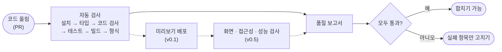
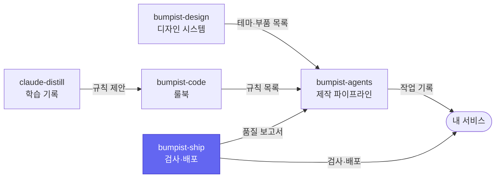

# bumpist-ship

**어느 저장소든 파일 하나만 추가하면, 코드가 올라올 때마다 같은 기준으로 자동 검사하고 결과를 기록으로 남겨요.**

저장소를 새로 만들 때마다 자동 검사 설정을 복사하고 고치는 일을 하지 않아도 돼요. 이 저장소의 검사 순서를 불러오기만 하면, 모든 저장소가 같은 기준으로 검사받아요. 결과는 사람이 읽는 로그와 함께 기계가 읽을 수 있는 보고서로도 남아서, AI가 무엇이 실패했는지 바로 알고 고칠 수 있어요.

> **지금 상태 — v0 (0단계).** 기본 자동 검사(`ci.yml`), 의존성 업데이트 공용 설정, 로컬 작업 공간 스크립트가 동작해요. 미리보기 배포와 화면 검사는 다음 단계부터 들어와요.

## 어떤 문제를 푸나요

| 지금까지 | bumpist-ship을 쓰면 |
| --- | --- |
| 저장소마다 자동 검사 설정을 복사해서, 조금씩 다르게 굴러가요 | 모든 저장소가 같은 검사 순서를 한 곳에서 불러와요 |
| 검사를 고치면 저장소 수만큼 고쳐야 해요 | 이곳 한 군데만 고치면 돼요 |
| 실패 이유가 긴 로그 안에 묻혀 있어요 | 무엇이 통과하고 실패했는지가 정해진 형식의 보고서로 남아요 |
| 라이브러리 업데이트를 저장소마다 따로 챙겨요 | 공용 설정 하나로 매주 같은 시간에 업데이트 제안이 와요 |

## 어떻게 동작하나요



점선은 다음 단계에서 들어올 검사예요. 들어오면 같은 보고서에 결과가 합쳐져요.

## 써 보기

### 1. 자동 검사 붙이기

저장소에 `.github/workflows/ci.yml` 파일을 만들고 아래를 그대로 넣어요.

```yaml
name: ci
on: [pull_request, push]
jobs:
  ci:
    uses: parksubeom/bumpist-ship/.github/workflows/ci.yml@v0
```

다음에 코드를 올리면 GitHub의 PR 화면에 `ci / ci` 검사가 생겨요.

- `package.json`에 `typecheck`, `lint`, `test`, `build`, `check:schemas` 같은 명령이 **있으면 실행하고, 없으면 건너뛰어요.** 그래서 처음부터 다 갖추지 않아도 붙일 수 있어요.
- 지금은 pnpm을 쓰는 저장소만 지원해요(`pnpm-lock.yaml`이 있어야 해요).
- 검사가 끝나면 결과가 `quality-ci`라는 이름의 보고서 파일로 저장돼요.

### 2. 의존성 업데이트를 공용 설정으로 받기

[Renovate](https://github.com/apps/renovate) 앱을 설치하고, 저장소에 `renovate.json`을 이렇게 만들어요.

```json
{
  "$schema": "https://docs.renovatebot.com/renovate-schema.json",
  "extends": ["github>parksubeom/bumpist-ship//renovate/default"]
}
```

매주 월요일 오전 9시 전(한국 시간)에 업데이트 제안이 와요. Bumpist 제품군 패키지는 한 묶음으로, 언제든 바로 와요.

이 공용 설정은 태그가 아니라 이 저장소의 main에서 바로 읽혀요. 그래서 설정을 바꾸면 쓰는 모든 저장소에 곧바로 적용돼요.

### 3. 다섯 저장소를 한 번에 받아 함께 고치기 (제품군 개발자용)

```bash
bash scripts/dev-workspace.sh ~/code/bumpist
cd ~/code/bumpist && pnpm install
```

다섯 저장소를 나란히 받고, 서로의 패키지를 연결해요. 한 저장소에서 고친 것을 배포하기 전에 다른 저장소에서 바로 써 볼 수 있어요. Windows에서는 Git Bash로 실행해요.

## 버전 고르는 법

| 이렇게 쓰면 | 결과 |
| --- | --- |
| `@v0` | v0 안에서 검사 방식이 바뀌면 자동으로 따라가요. 보통은 이걸 쓰면 돼요 |
| `@v0.1.0` | 언제나 같은 검사를 받아요. 검사가 바뀌는 게 싫을 때 써요 |

태그를 언제 어떻게 옮기는지는 [RELEASING.md](./RELEASING.md)에 있어요.

## 지금 되는 것과 아직 안 되는 것

| 시점 | 들어오는 것 |
| --- | --- |
| **지금 (v0)** | 기본 자동 검사, 품질 보고서 형식(C5), Renovate 공용 설정, 로컬 작업 공간 스크립트 |
| ship v0.1 (2~6주차) | 데이터베이스 검사(다른 사용자의 데이터에 접근할 수 없는지 확인), Vercel 미리보기·운영 배포 |
| ship v0.5 (7~12주차) | 미리보기 화면 자동 점검(동작·접근성·성능), AI 화면 품질 평가, AI 코드 리뷰, 패키지 배포, 운영 키트(오류 추적·분석·약관 템플릿) |

## 이런 경우엔 맞지 않아요

- **GitHub Actions가 아닌 곳**(GitLab, Jenkins 등)에서는 쓸 수 없어요.
- **npm이나 yarn만 쓰는 저장소**는 아직 지원하지 않아요.
- **저장소마다 검사를 크게 다르게 하고 싶다면** 맞지 않아요. 이 저장소는 같은 기준을 나눠 쓰기 위한 곳이에요.

## 다른 도구가 읽는 파일 형식

| 형식 | 담는 것 | 정의 |
| --- | --- | --- |
| C5 품질 보고서 | 검사 항목별 결과, 실패한 규칙 번호, 미리보기 주소 | [`schemas/quality/v0.json`](https://parksubeom.github.io/bumpist-ship/schemas/quality/v0.json) |

## Bumpist Suite 안에서

다섯 저장소는 서로의 코드를 가져다 쓰지 않고, 정해진 형식의 파일만 주고받아요. 그래서 하나만 골라 써도 되고, 모두 연결해 쓸 수도 있어요. 색칠된 칸이 이 저장소예요.

| 저장소 | 한 줄 설명 |
| --- | --- |
| [bumpist-design](https://github.com/parksubeom/bumpist-design) | 서비스마다 색만 바꾸면 되는 디자인 시스템 |
| [bumpist-agents](https://github.com/parksubeom/bumpist-agents) | 아이디어에서 미리보기 링크까지 가는 Claude Code 작업 순서 |
| [bumpist-code](https://github.com/parksubeom/bumpist-code) | AI가 매번 같은 방식으로 코드를 쓰게 하는 룰북 |
| [bumpist-ship](https://github.com/parksubeom/bumpist-ship) | 파일 하나로 붙이는 자동 검사·배포 |
| [claude-distill](https://github.com/parksubeom/claude-distill) | Claude가 대화에서 배운 것을 자동으로 기록 |



## 라이선스

MIT
