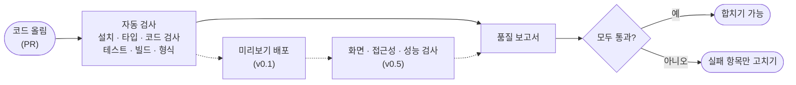

<h1 align="center"></h1>

<p align="center">
  
  
  
</p>

<p align="center">
  <a href="#써-보기">써 보기</a> · <a href="#어떻게-동작하나요">동작 방식</a> · <a href="#버전-고르기">버전 고르기</a> · <a href="#bumpist-저장소">다른 저장소</a>
</p>

저장소에 파일 하나만 넣으면, 코드가 올라올 때마다 같은 기준으로 자동 검사해요.

> [!NOTE]
> 지금은 v0이에요. 기본 자동 검사(`ci.yml`), 의존성 업데이트 공용 설정, 로컬 작업 공간 스크립트가 동작해요.

## 왜 필요한가요

- 저장소마다 자동 검사 설정을 복사하다 보면 조금씩 다르게 굴러가요.
- 검사를 고치려면 저장소 수만큼 고쳐야 해요.
- 실패 이유가 긴 로그 속에 묻혀 있어요.

bumpist-ship을 쓰면 모든 저장소가 여기 있는 검사 순서를 불러와요. 고칠 때는 이곳 한 군데만 고치면 되고, 결과는 기계가 읽는 보고서로도 남아서 AI가 무엇이 실패했는지 바로 알 수 있어요.

## 써 보기

저장소에 `.github/workflows/ci.yml`을 만들고 아래를 그대로 넣어요.

```yaml
name: ci
on: [pull_request, push]
jobs:
  ci:
    uses: parksubeom/bumpist-ship/.github/workflows/ci.yml@v0
```

다음에 코드를 올리면 PR 화면에 `ci / ci` 검사가 생겨요.

- `package.json`에 `typecheck`, `lint`, `test`, `build`, `check:schemas`가 있으면 실행하고, 없으면 건너뛰어요. 처음부터 다 갖추지 않아도 붙일 수 있어요.
- 검사가 끝나면 결과가 `quality-ci`라는 보고서 파일로 저장돼요.

> [!IMPORTANT]
> 지금은 pnpm을 쓰는 저장소만 지원해요. `pnpm-lock.yaml`이 있어야 해요.

<details>
<summary>의존성 업데이트를 공용 설정으로 받기 (Renovate)</summary>

[Renovate](https://github.com/apps/renovate) 앱을 설치하고, 저장소에 `renovate.json`을 이렇게 만들어요.

```json
{
  "$schema": "https://docs.renovatebot.com/renovate-schema.json",
  "extends": ["github>parksubeom/bumpist-ship//renovate/default"]
}
```

매주 월요일 오전 9시 전(한국 시간)에 업데이트 제안이 와요. Bumpist 제품군 패키지는 한 묶음으로, 언제든 바로 와요.

이 공용 설정은 태그가 아니라 이 저장소의 main에서 바로 읽혀요. 그래서 설정을 바꾸면 쓰는 모든 저장소에 곧바로 적용돼요.

</details>

<details>
<summary>다섯 저장소를 한 번에 받아 함께 고치기 (제품군 개발자용)</summary>

```bash
bash scripts/dev-workspace.sh ~/code/bumpist
cd ~/code/bumpist && pnpm install
```

다섯 저장소를 나란히 받고, 서로의 패키지를 연결해요. 배포하기 전에 다른 저장소에서 바로 써 볼 수 있어요. Windows에서는 Git Bash로 실행해요.

</details>

## 어떻게 동작하나요

1. PR이 올라오면 설치, 타입 검사, 코드 검사, 테스트, 빌드, 형식 검사를 차례로 돌려요.
2. 결과를 하나의 품질 보고서로 모아요.
3. 모두 통과하면 합칠 수 있고, 실패하면 실패한 항목만 고치면 돼요.

미리보기 배포는 v0.1, 화면·접근성·성능 검사는 v0.5에 들어오고, 그 결과도 같은 보고서에 합쳐져요.

<details>
<summary>같은 흐름을 그림으로 보기</summary>



점선은 다음 단계에서 들어올 검사예요.

</details>

## 버전 고르기

- **`@v0`**: v0 안에서 검사 방식이 바뀌면 자동으로 따라가요. 보통은 이걸 쓰면 돼요.
- **`@v0.1.0`**: 언제나 같은 검사를 받아요. 검사가 바뀌는 게 싫을 때 써요.

태그를 언제 어떻게 옮기는지는 [RELEASING.md](./RELEASING.md)에 있어요.

## 이런 경우엔 안 맞아요

- GitHub Actions가 아닌 곳(GitLab, Jenkins 등)에서 써요.
- npm이나 yarn만 쓰는 저장소예요.
- 저장소마다 검사를 크게 다르게 하고 싶어요.

<details>
<summary>버전별로 들어오는 것</summary>

| 시점 | 들어오는 것 |
| --- | --- |
| **지금 (v0)** | 기본 자동 검사, 품질 보고서 형식(C5), Renovate 공용 설정, 로컬 작업 공간 스크립트 |
| v0.1 (2주차부터 6주차) | 데이터베이스 검사(다른 사용자의 데이터에 접근할 수 없는지 확인), Vercel 미리보기·운영 배포 |
| v0.5 (7주차부터 12주차) | 미리보기 화면 자동 점검(동작·접근성·성능), AI 화면 품질 평가, AI 코드 리뷰, 패키지 배포, 운영 키트 |

</details>

<details>
<summary>다른 도구가 읽는 파일 형식</summary>

- C5 품질 보고서: 검사 항목별 결과, 실패한 규칙 번호, 미리보기 주소 ([스키마](https://parksubeom.github.io/bumpist-ship/schemas/quality/v0.json))

</details>

## Bumpist 저장소

하나만 골라 써도 되고, 함께 쓰면 서로 파일을 주고받아요.

| 저장소 | 하는 일 |
| --- | --- |
| [bumpist-design](https://github.com/parksubeom/bumpist-design) | 색만 바꾸면 되는 디자인 시스템 |
| [bumpist-agents](https://github.com/parksubeom/bumpist-agents) | 아이디어에서 미리보기까지 가는 작업 순서 |
| [bumpist-code](https://github.com/parksubeom/bumpist-code) | AI가 같은 방식으로 코드를 쓰게 하는 룰북 |
| **bumpist-ship (지금 보는 곳)** | 파일 하나로 붙이는 자동 검사 |
| [claude-distill](https://github.com/parksubeom/claude-distill) | Claude가 배운 것을 자동으로 기록 |

## 라이선스

MIT
